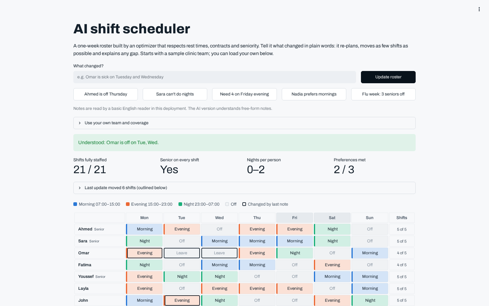

# AI shift scheduler

**Live demo:** https://slimaneoptic-scheduler.streamlit.app

A one-week roster built by a constraint-programming optimizer. It starts with a 12-person clinic team, and you can **load your own team and coverage** in the app. Managers change it in plain words, like *"Ahmed is off Thursday"* or *"Need 4 on Friday evening"*, and it re-plans while moving as few shifts as possible.



## Highlights
- **Your own team:** edit people (senior, min/max shifts) and the people needed per shift, then re-solve
- **Explains every gap:** *"Fri night: 1 of 2 staffed. Everyone else: 3 on leave, 4 at their weekly maximum…"*
- **Never leaves a shift empty:** when staff is short, the shortage is spread instead
- **Excel export:** color-coded roster, coverage check, per-person totals

## Rules

**Always respected:** one shift per day · at least 11 h of rest between shifts · max 3 nights in a row · contract limits (full-time / part-time) · approved leave · blocked shifts.

**Optimized:** required staff on every shift and a senior on each (it reports gaps rather than failing) · fair spread of nights and weekends · personal preferences · minimal disruption when the plan changes.

## Plain-language changes
- **With an OpenRouter API key:** an AI model (Gemini 3.8 Flash, ~3 s; free models take over if credits run out) reads free-form notes ("omar called in sick tue and wed, need 4 people friday evening") and returns changes that match a strict JSON schema. Every change is validated before it reaches the solver.
- **Without a key, or when every model is busy:** a built-in English reader handles common phrasings (off / sick / leave, can't do nights, need N on a shift, prefers / avoids, max N shifts).

## How it works
Google OR-Tools CP-SAT. Coverage and seniority are soft constraints with very high penalties, so an impossible week still returns the best roster along with the exact shortages. Re-planning adds a penalty for every shift moved compared with the current roster.

## Run locally
```bash
pip install -r requirements.txt
export OPENROUTER_API_KEY=your-key   # optional
streamlit run app.py
pytest -q tests
```
Optional: `OPENROUTER_MODELS="model-a,model-b"` overrides the model list (default: Gemini 3.8 Flash, then free backups; see `llm.py`).

## Need this for your team?

Multiple wards or sites, skills and certifications, monthly horizons, overtime costs, labor-law checks, and import from your HR system or Excel. I build these tools. https://www.upwork.com/freelancers/~01d6ae0f1a06a43ac0
